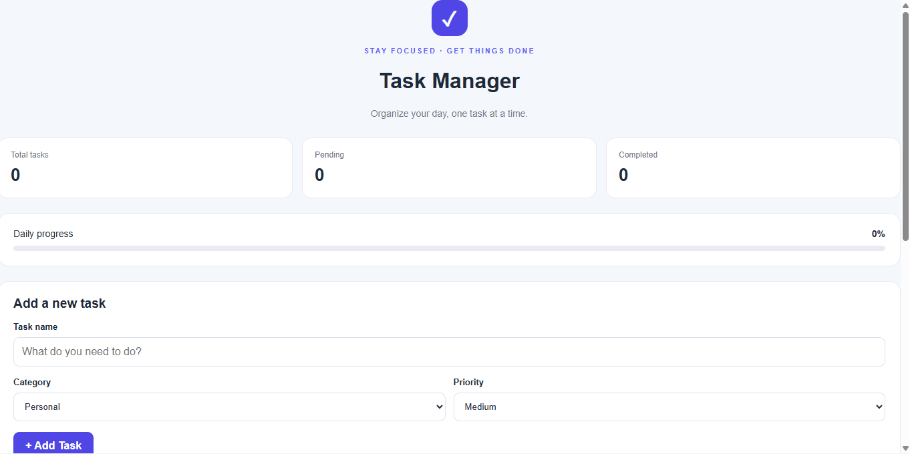
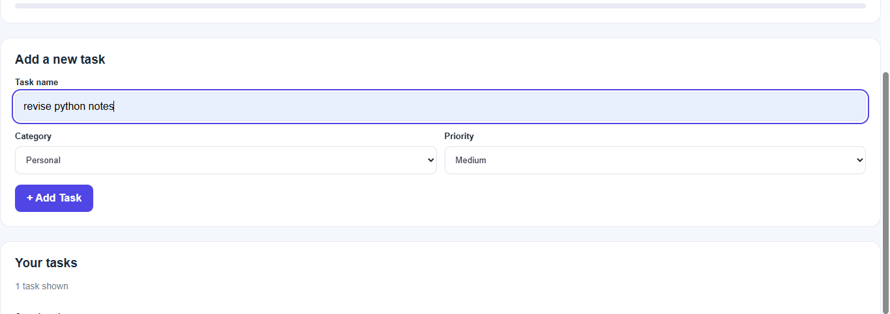
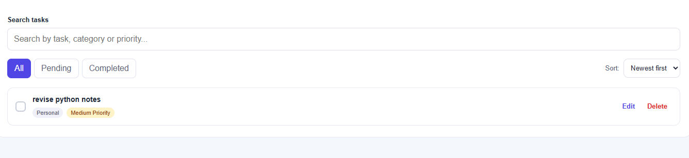
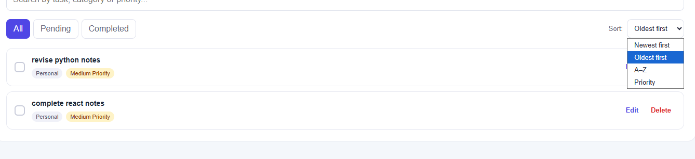
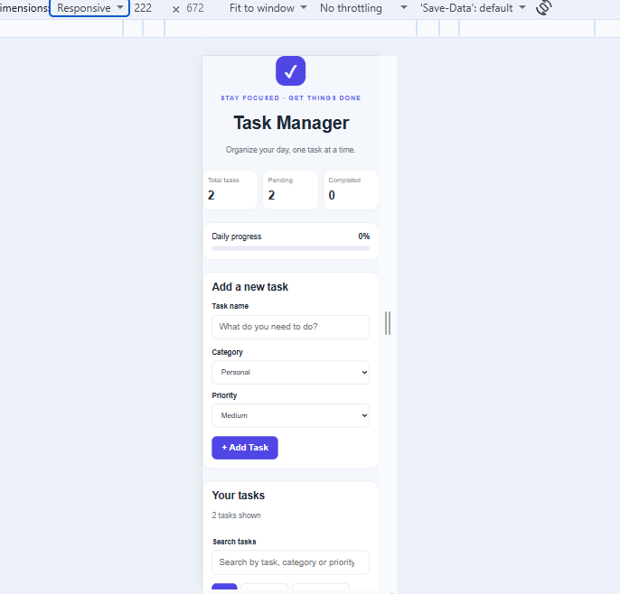

# ✅ React Task Manager

A responsive and interactive **Task Manager application** built with React.js to help users organize daily tasks, manage priorities, and track their productivity. The application includes task creation, editing, deletion, filtering, sorting, and Local Storage persistence.

## 📸 Screenshots

> Add your actual project screenshots to the `screenshots` folder and update the image paths below.

### 1. Home Page


### 2. Add Task


### 3. Task Management


### 4. Search, Filter and Sort


### 5. Responsive Design


## ✨ Features

- **Add Tasks:** Create tasks with a task name, category, and priority.
- **Edit Tasks:** Update task details, categories, and priorities.
- **Delete Tasks:** Remove tasks that are no longer needed.
- **Mark as Completed:** Mark tasks as completed or pending.
- **Task Categories:** Organize tasks into Personal, Study, Work, and Other categories.
- **Priority Management:** Assign Low, Medium, or High priority to tasks.
- **Task Filtering:** View All, Pending, or Completed tasks.
- **Search Tasks:** Search by task name, category, or priority.
- **Task Sorting:** Sort tasks by newest, oldest, alphabetical order, or priority.
- **Progress Tracking:** View total, pending, and completed task counts with a completion percentage.
- **Local Storage:** Automatically save tasks in the browser so they remain available after refreshing the page.
- **Input Validation:** Prevent empty task names and limit task names to 150 characters.
- **Clear Completed Tasks:** Remove all completed tasks at once.
- **Responsive Design:** Adapt the interface for desktop, tablet, and mobile screens.
- **Accessible Controls:** Use labels, keyboard focus indicators, and descriptive button labels.

## 🛠️ Technologies Used

- **React.js** — Component-based user interface.
- **JavaScript (ES6+)** — Application logic and event handling.
- **HTML5** — Application structure.
- **CSS3** — Styling, responsive layouts, and visual effects.
- **React Hooks** — `useState`, `useEffect`, and `useMemo`.
- **Browser Local Storage** — Persistent task data.
- **Create React App** — Development and build tooling.
- **Git and GitHub** — Version control and source code hosting.

## 📂 Project Structure

```text
react-task-manager/
├── public/
│   └── index.html
├── src/
│   ├── components/
│   │   ├── TaskInput.js
│   │   ├── TaskItem.js
│   │   └── TaskList.js
│   ├── App.js
│   ├── App.css
│   ├── index.js
│   └── index.css
├── screenshots/
│   ├── home.png
│   ├── add-task.png
│   ├── task-management.png
│   ├── filter-sort.png
│   └── responsive.png
├── .gitignore
├── package.json
├── package-lock.json
└── README.md
```

## ⚙️ Installation and Setup

Follow these steps to run the project locally.

### Prerequisites

- [Node.js and npm](https://nodejs.org/)
- [Git](https://git-scm.com/)
- A code editor such as Visual Studio Code

### 1. Clone the Repository

```bash
git clone https://github.com/pradum6391-wq/react-task-manager.git
```

### 2. Navigate to the Project Folder

```bash
cd react-task-manager
```

### 3. Install Dependencies

```bash
npm install
```

### 4. Start the Development Server

```bash
npm start
```

The application will open at:

```text
http://localhost:3000
```

If it does not open automatically, visit the URL in your browser.

### 5. Create a Production Build

```bash
npm run build
```

This command creates an optimized production build in the `build` directory.

## 🚀 How to Use

1. Open the Task Manager application.
2. Enter a task name.
3. Select a category and priority.
4. Click **Add Task**.
5. Mark tasks as completed using the checkbox.
6. Use **Edit** to update task details.
7. Use **Delete** to remove individual tasks.
8. Search for tasks or filter them by status.
9. Choose a sorting option to organize the list.
10. Use **Clear completed** to remove all completed tasks.

Your tasks are stored in your browser's Local Storage and normally remain available after refreshing the page in the same browser.

## 💾 Data Storage

This project uses the browser's **Local Storage** to persist task data.

- Tasks are saved automatically when the task list changes.
- Saved tasks are restored when the application loads.
- No separate database or backend server is required.
- Tasks are stored locally in the browser and are not automatically synchronized across devices or browsers.
- Clearing browser site data may remove the saved tasks.

## 📱 Responsive Design

The interface is designed to work across different screen sizes, including:

- Desktop computers
- Laptops
- Tablets
- Mobile phones

## 🔮 Future Improvements

Potential enhancements for future versions include:

- Due dates and reminders
- Drag-and-drop task ordering
- Dark and light themes
- User authentication
- Cloud-based data storage and synchronization
- Exporting and importing tasks
- Calendar integration

## 🎓 Learning Outcomes

This project demonstrates practical experience with:

- React functional components and reusable UI.
- Managing application state with `useState`.
- Handling side effects with `useEffect`.
- Optimizing derived data with `useMemo`.
- Handling forms and validating user input.
- Implementing CRUD operations: Create, Read, Update, and Delete.
- Searching, filtering, and sorting data.
- Persisting application state with Local Storage.
- Responsive CSS and accessible interface controls.
- Running and building a React application using Create React App.

## 👨‍💻 Author

**Pradum Maurya**

- GitHub: [pradum6391-wq](https://github.com/pradum6391-wq)
- LinkedIn: [Pradum Maurya](https://linkedin.com/in/pradum-maurya-902a0b379)

## 📄 License

This project is created for educational and internship purposes. You may adapt it for learning and personal projects.

